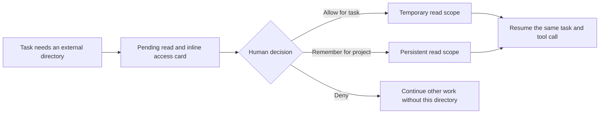
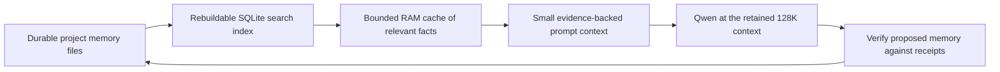

# Access recovery, internet and hybrid memory

26 October 2026, Asia/Muscat. Directory access, controlled internet and hybrid
memory are implemented locally. Read the current
[internet and project-memory implementation](INTERNET_AND_PROJECT_MEMORY.md)
for installed dependencies, settings, limits and acceptance evidence. The
internet/memory design sections below preserve the original planning rationale.
The Qwen profile remains 131,072 context / 8,192 output. The previous GitHub
checkpoint is `673eef6`.

## Implemented: grant access and continue

The GUI exposes an inline **Grant folder access** card containing the exact
canonical folder and the AI's short reason:

- **Allow for this task:** read-only authority ends with the task.
- **Remember for this project:** persist a read-only registered location; later
  requests to that location can reuse the remembered decision.
- **Deny:** return a denial for that folder; continue other work. The same task
  will not repeatedly ask about a folder the user declined.

Existing registered project read permission is reused when the AI requests that
scope; it does not cause another prompt. New, unregistered folders need a human
decision. This keeps the location policy as the source of permission authority.

No completed tool action is replayed. The job ID, transcript, tool session,
receipts and OpenCode session remain in place. Browser reconnect/polling shows
the pending card again. A backend process restart still interrupts the task;
its journal and completed receipts remain authoritative. This is not a promise
to resume a killed model process or restore an operating-system socket.

The job remains `running` so it continues owning its workspace/database, with
phase `Waiting for directory access`. The controller holds the pending read,
and the authenticated UI resolves its exact job/request ID and policy revision.
The AI cannot approve itself or supply an approval through tool arguments.

Two entry routes are supported:

1. A selected task folder is unregistered: admission records the job and waits
   before sending the model prompt, rather than rejecting the whole submission.
2. During a task, `request_directory_access` asks for a different directory.
   A read-only inventory/header/archive/text tool attempted with an absolute
   external path also pauses that exact invocation and normalizes its path after
   approval. Relative traversal remains rejected.

Inventory/text/header/archive descriptors are available up front when the GUI
advertises interactive access, so approving a scope does not require rebuilding
the agent's tool list or starting a new inference task. The fixed bridge cap is
now 48 descriptors; the current all-grants interactive manifest contains 36,
including the two knowledge tools.

`read_inventory_file` supplies bounded UTF-8 reads after access is approved:
128 KiB maximum input, pages up to 16,000 characters, exact full-file SHA-256 and
the active directory. It cannot execute content, follow links, traverse out of
scope or read credential/key files. Binaries use the existing archive/REA tools.

Existing explicit operator denials/exclusions and protected paths must be
reviewed in Settings; quick approvals do not override them. Scope approval adds
no writes, execution, shell, internet, game launches or administrator authority.
The new location excludes `.git`, `.smelter`, protected projects and common secret
files. Remembered locations can be disabled/removed in Access settings.

Requests are limited to eight per task and expire after five minutes. Stop wakes
the waiting operation without granting access. Pending human time is excluded
from both GUI engines' overall task deadlines. The tool transport has a bounded allowance
for that wait; actual compiler/parser/model execution limits are unchanged.
The RPC ceiling is 900 seconds, with fixed per-operation budgets below it.

Human request/decision records are in `.smelter/access-requests/<job-id>.jsonl`,
included in normal artifact quotas, retention and backups. Task grants are memory
only; remembered grants live in the project's existing access-policy store.

The GUI discovers this feature from `/api/access-policy` before sending the new
`access_requests` flag. Old running backends receive no unsupported permission field;
the updated JavaScript does not require them to support the new request endpoint.
Interactive approval is a GUI controller operation. Standalone native MCP does
not fabricate a human decision or display a third-party Melty approval dialog.

## Original design: controlled internet tools (now implemented)

Add a host-controlled, read-only web broker through MCP while the agent container
retains its no-network boundary. Start with public documentation, GitHub source,
release metadata and bounded HTTPS page fetches; add a search provider adapter
behind the same interface once the provider and any credentials are configured.

Each result should include the requested/final URL, retrieval time, title,
content hash, truncated/page state and source text. Qwen should cite these actual
results, distinguish cached from live data and treat page instructions as
untrusted reference material. A website never grants local access or permission
to run its commands.

The broker needs public-address validation, DNS/address pinning with correct TLS
hostname verification, redirect revalidation, private/loopback/link-local/metadata
blocking, HTTPS-only URLs, time/byte budgets and no ambient cookies or credentials.
The official [OWASP SSRF prevention guidance](https://cheatsheetseries.owasp.org/cheatsheets/Server_Side_Request_Forgery_Prevention_Cheat_Sheet.html)
describes why URL validation, redirects and network destinations need explicit
controls. Downloads/installers should use a distinct, reviewable route with
source/version/checksum verification and requirements/documentation updates.

Proposed UI: Internet **Off / Documentation domains / Public web**, source cards,
an activity indicator, cancellation and a visible cache state. Domain choices
should persist for the project to avoid repetitive prompts. No search API key or
new network package has been installed in this access-recovery stage.

## Original design: files + searchable index + RAM (now implemented)

Use project-scoped durable Markdown/JSON for verified facts, decisions, task
checkpoints, compatibility findings and file/evidence hashes. Keep the index
rebuildable from those files. SQLite FTS5 provides local keyword retrieval;
its [official documentation](https://www.sqlite.org/fts5.html) covers full-text
search, ranking and snippets. The installed Python SQLite 3.50.4 successfully
created an in-memory FTS5 table during this review, so the first stage does not
need a separate database service.

A reasonable initial cache budget is 64 MiB of ordinary CPU RAM with LRU/TTL
eviction. Cache identity should include project, source hash/mtime, schema and
model/embedding version when relevant. Stale facts should be refreshed, not
silently treated as current. Optional local embeddings can add semantic retrieval
later; pin the selected model and record it in requirements before installing.

Retrieve a small relevant memory pack within the existing 128K prompt budget.
RAM cache is not Qwen's GPU KV cache, more tokens, training, or the whole chat
history inserted into every prompt. Most practical benefit should come from
recovering relevant evidence and reducing repeated work/prompt material; it does
not directly increase token-generation speed.

Give memory entries a source, timestamp, scope and state such as verified,
user-supplied or unverified. Store completed action receipts and checkpoints to
avoid replaying writes/builds after interruption. Keep credentials out of memory,
do not treat old access decisions as new authority, and isolate projects.
Provide Inspect/Edit/Forget controls and an explicit distinction between a
recalled fact and a newly observed tool result.

## Remaining game gates

Directory access, the web broker/source cards and files/FTS5/RAM memory are now
implemented. Optional semantic retrieval remains future work after measuring
keyword recall. Use this foundation for one end-to-end game-mod slice. ARK
IoStore metadata works, but its PAK v12 exceeds pinned repak support. Verify
matching cooking, loader/build and runtime bindings before claiming in-game
compatibility.

Tests cover same-job continuation, real MCP reads after approval, the real Node
proxy waiting on a human decision, HTTP auth/stale decisions, task/project scope,
denial, cancellation, expiry, multiple scopes, audit failures, text-read bounds
and inline-card rendering/actions. Final counts and live status are recorded in
the current handover after the full regression run.

The access-only checkpoint passed 591 dashboard tests (nine skipped), 111 setup
tests and 32 JavaScript tests; the denial-subtree refinement passed all 16
focused access tests. The subsequent internet/memory implementation has a larger
regression suite and a real Qwen acceptance. See
[CURRENT_HANDOVER.md](CURRENT_HANDOVER.md) for final counts and the current GUI
PID. Both saved model routes remain 128K/8K. These changes are local; GitHub's
prior checkpoint is still `673eef6`.
