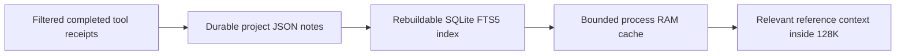

# Internet and hybrid project memory

Implemented locally on 26 October 2026. These features extend the existing
[resumable folder-access flow](ACCESS_REQUESTS_AND_MEMORY_ROADMAP.md). The model
profile stays at **131,072 context / 8,192 output tokens**.

## Current operation

Open **Settings → Internet & memory**. Internet is currently set to
**Documentation domains** in this checkout. New projects default to **Off**.
Choose Off, Documentation domains, or Public web; edit the documentation domain
list and save. Domain entries include their subdomains. The task receives
`web_read` only after the UI has loaded enabled project settings; the controller
also checks the current setting on every operation, including cached reads.

`web_access` exposes two fixed read-only actions:

- `search`: a query of at most 240 characters, returning up to eight source links
  and snippets from the local SearXNG provider. Queries go to public search
  engines even in documentation mode; that mode filters the returned sources.
  An upstream engine error is reported as incomplete coverage.
- `fetch`: a public HTTPS page, optionally with `offset`, `limit` and
  `refresh:true`. Results include the requested/final URLs, retrieval time,
  text, links, body hash, completeness and pagination. Refresh bypasses the
  saved page. Source cards distinguish live and cached results in chat history.

The broker accepts HTTPS on port 443, validates all DNS answers and pins the
connection to an approved numeric address while retaining TLS hostname checks.
Redirects are revalidated. Private, loopback, link-local and encoded transition
addresses are blocked. It sends no ambient credentials, cookies, proxy settings,
uploads or executable content. HTML becomes plain text; scripts do not run.
Credential-bearing URL parameters and common secret patterns are rejected, but
this is not a general detector for every possible secret. Keep queries public.

Fetches have a 25-second overall/cancellation watchdog, three redirects, a 1 MiB
raw response limit, 100,000 extracted characters and 16,000 characters per page.
DNS work has a bounded queue and worker pool. Compressed/non-text/binary responses
are rejected. A partial body hash is labelled incomplete. The 128-entry extracted
page cache lives in `.smelter/web-cache/`, defaults to 600 seconds and never
silently relabels old text as a fresh observation.

Web results, search snippets and memory notes are reference data. Their contents
cannot grant directory access or authorize execution. The managed OpenCode
container retains its existing no-network configuration; approved web operations
run in the host controller. Native OpenCode retains its own host permissions.

## Reproducible search provider

The new installed dependency is official
[SearXNG](https://github.com/searxng/searxng), version
`2026.10.25-54ca1d9cf`, revision
`54ca1d9cfb08674f66261d7f351b063558dfcc62`. Its immutable Linux/amd64 image is:

```text
docker.io/searxng/searxng@sha256:a886f6511fd3faf2c9ed921b33a8f0df1c7646e47475b6b309e79cd2887abd9d
```

Pins are recorded in `tools/modding/requirements-web.json` and the `web_search`
profile in `system-requirements.json`.

```powershell
python tools/setup/install_web_search.py --start --enable-docs
python tools/setup/configure_melty_cli.py --enable-knowledge --apply
```

The installer requires local Docker Linux containers. Without `--start` it
prepares the image/configuration; without `--enable-docs` it preserves the
project's internet mode. It preserves existing settings, refuses foreign or
wrong-image containers and leaves a stopped container for inspection. It never
silently replaces a service. Configuration and its installation receipt are in
`.smelter/tooling/web-search/`; keep the generated service secret private.

The service binds only `127.0.0.1:8842`, runs as UID 65534 with a read-only root,
dropped capabilities, no-new-privileges, 512 MiB memory, two CPUs, 128 PIDs and
bounded tmpfs/logs. Only its own configuration is mounted; it receives no
workspace, credential store, model endpoint or Docker socket mount. It uses
ordinary Docker bridge outbound networking to DuckDuckGo, Brave and Bing. That
helper is not an outbound-network firewall. No API key, subscription or Python
package was added. See the official
[container installation](https://docs.searxng.org/admin/installation-docker.html)
and [search API](https://docs.searxng.org/dev/search_api.html).

## Files, index and RAM

Memory has three separate layers:



Durable source notes are `.smelter/project-memory/notes/<UUID>.json`, with title,
text, kind, sources, timestamps, origin and confidence. The existing selected
project database stores a rebuildable [SQLite FTS5](https://www.sqlite.org/fts5.html)
index. There is no new database server or embedding model. Search is keyword
retrieval, not semantic embeddings or model training.

Memory defaults to enabled, automatic completion checkpoints enabled, **64 MiB
estimated CPU RAM per process** and a **12,000-character reference pack** within
the existing context budget. RAM can be Off/16/32/64 MiB. It has LRU/300-second TTL
eviction, 1,000 entries and a global 64 MiB estimated-object budget per process.
GUI and persistent native MCP processes have independent RAM caches and share
the project files/database. Clear RAM clears the current controller's cache;
it does not clear another native process. Human UI searches bypass RAM.

Project root, selected database and file metadata participate in cache identity;
file changes invalidate recall. Rebuild index validates and hashes the source
files again. A process restart can reconstruct retrieval from those files.
Limits are 500 notes / 16 MiB total, 96 KiB per note and 16,000 text characters
per note. Ordinary age-based artifact cleanup excludes durable notes. Backups
and storage quotas include them.

`project_memory` permits search, exact-ID read and remember. Model-created notes
are always **unverified**. Human notes/edits are **user_supplied**. Controller
completion checkpoints are **receipt_checkpoint**: they retain filtered tool
statuses, IDs, paths and hashes, not model prose, permissions, raw web bodies or
whole file contents. Only the last 100 controller checkpoints are retained;
human/model notes are not automatically pruned. Repeated capture of the same job
uses the same note identity.

Both GUI engines receive bounded relevant reference context. Native
Melty/OpenCode receives the tools and `project-knowledge` skill and searches
memory when needed; it does not receive the GUI's automatic context pack.
Remembered access decisions remain in the access-policy store, never in memory
as reusable authority. Corrupt/unavailable optional recall yields an empty pack
and warning; it does not discard the task's completed work.

The UI provides search, inspect, new/edit/forget, clear RAM and rebuild index.
Edits/forget use the current note hash; settings use current revisions. The
model cannot set its own origin/confidence or call human edit/forget actions.
Off blocks model reads/writes while leaving human management available.
Forget removes the source note and invalidates recall; earlier chat receipts,
backups or another process's temporary data may still retain copies.

One production note records actual user decisions from this conversation:
`e03a3746-9542-4719-b682-957da1a4c9c6` (`User project decisions`). Other acceptance
notes were written only in an isolated fixture project.

## Verification and continuation

The live native OpenCode/Qwen acceptance passed all four operations: search,
fresh upstream fetch, remember and recall at 131,072/8,192. Its structured answer
correctly labelled the saved finding unverified and game runtime untested.
Evidence: `.smelter/knowledge-runs/qwen-1e834003f25047f8bfded52b5f292857/report.json`.
Repeat with `python tools/analysis/smoke_qwen_knowledge.py`; it uses isolated
memory/database state and the existing search provider.

Regression commands:

```powershell
python -m unittest discover -s tools/dashboard -p "test_*.py"
python -m unittest discover -s tools/setup -p "test_*.py"
node --test tools/dashboard/test_*.js
```

Tests include private-address/redirect rejection, pinned TLS hostname, deadlines,
refresh/cache behaviour, concurrent tool-call budgets, API authorization,
unverified model notes, human hash checks, project isolation, both GUI recall
paths and a fresh-process persistence check. Final results: 616 dashboard tests
(nine skipped), 116 setup tests and 37 JavaScript tests passed. Real desktop and
mobile Chromium checks passed with no page errors. Reports/screenshots and the
current GUI port/PID are recorded in [CURRENT_HANDOVER.md](CURRENT_HANDOVER.md).

For an idle Windows dashboard only, `tools/setup/reload_dashboard.py` accepts
the exact PID and this checkout's launch log. It authenticates root/port,
rechecks idle state, verifies listener/process identity and sends graceful Ctrl+C
only if its attached console contains exactly that dashboard and the helper.
It aborts on other console members or identity changes and never force-kills.
The replacement opens hidden in its own console; use its new private launch URL.
The helper resets Windows interrupt inheritance before spawning. The final GUI
currently uses port 8769; an older idle backend on 8768 was preserved after it
ignored a graceful interrupt. Two consecutive reloads on 8769 verified the fix.

Next engineering gate: use actual researched sources and remembered evidence for
one game-specific loader/build/cook/runtime slice. ARK IoStore metadata works;
its PAK v12 still exceeds pinned repak support. These features do not establish
game runtime compatibility.
