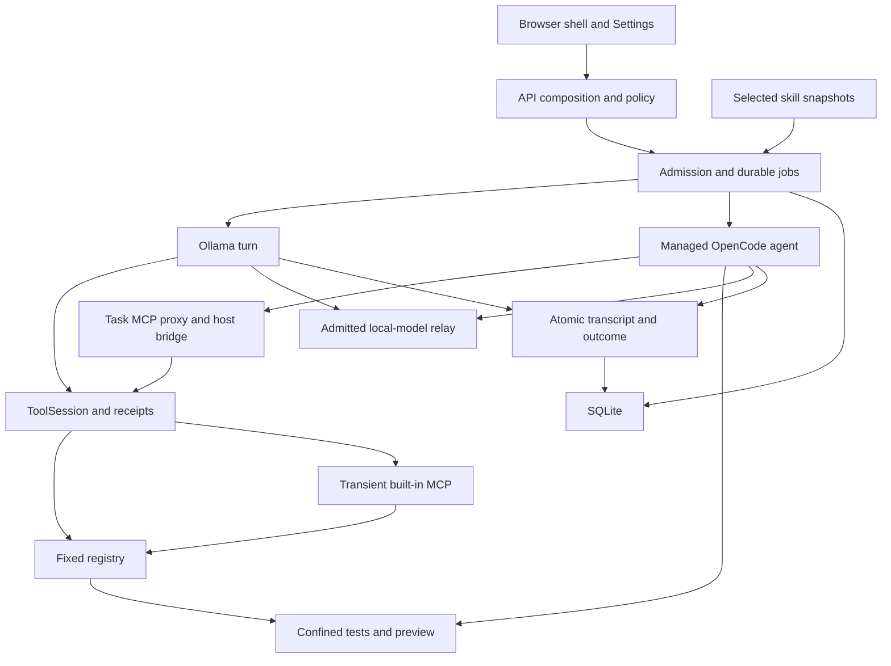
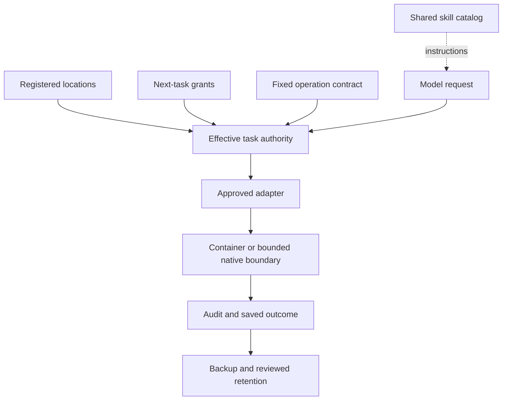

# System relationships and graph provenance

The generated graph/function index pins audited application
`cee565b24726a9c217eab21c8a75bac88cad8c9c`, including the universal OpenCode/MCP
bridge, coding workspace and analysis utilities. The [source manifest](graph/source-manifest.json)
records exact Git blob identities. See the [current audit](reviews/2026-10-21/workflow-audit/REVIEW.md)
for workflow findings and [evidence](reviews/2026-10-21/workflow-audit/evidence.json)
for actual execution checks. Graphify itself was not installed or run.

Pinned inventory: **272 scripts, 1,917 declarations/callbacks, 3,260 static
relationships, 11,363 unresolved call expressions and 74 manually reviewed runtime
links**. Unresolved expressions are not a defect count; static no-caller symbols
are not an automatic deletion list.

## Artifacts and meaning

| Artifact | Purpose |
| --- | --- |
| [Interactive graph](graph/system-graph.html) | Offline searchable files/functions, edge filters and local neighborhoods; download/open in a current browser |
| [Graph JSON](graph/system-graph.json) | Static file/function inventory, resolved relationships, unresolved expressions and limitations |
| [Runtime links](graph/runtime-links.json) | Manually reviewed cross-process/browser/persistence links, distinct from AST evidence |
| [Pinned manifest](graph/source-manifest.json) | Git commit/blob identities; builder rejects source mismatch |
| [Function index](FUNCTION_INDEX.md) | Per-file declarations, complexity estimates, pinned source links |
| [Review evidence](graph/review-evidence.json) | Fixture observations at the repaired revision; no real model/game |

Calls are resolved lexical/self/import candidates, not proof of execution. References represent callback/value use. Imports are module dependencies, not calls to every function. Runtime links are explicitly reviewed architecture records. Unresolved calls remain unresolved rather than receiving invented targets. No-static-incoming symbols include framework hooks and externally invoked compatibility APIs; they are not an automatic deletion list. Analysis utilities are included in this manifest. Embedded/generated runtime programs and PowerShell control flow still require separate review.

## Active controller and ownership



OpenCode has no container network. Model requests cross an owned fixed Docker-exec queue to native loopback Ollama. Preview has a separate dashboard-owned HTTP relay and temporary container data. Transient built-in MCP inherits parent policy/skill snapshots; it never owns persistent preview lifetime. Registered native inspection adapters remain bounded host processes, a separate boundary.

## Shared authority and storage



| Source | Shared consumer / distinction |
| --- | --- |
| skills / managed / legacy / contract manifests | Namespaced shared catalog and fingerprint monitor; duplicate identities fail closed; legacy/contract start disabled |
| Dashboard tool registry | Same direct/MCP schemas and policy/audit boundary |
| Legacy core Registry | Explicit connect_dashboard bridge; other adapters remain labelled library-only |
| SQLite snapshots | Model/runtime/access/sandbox configuration; authoritative dashboard state |
| JSON compatibility helpers | Legacy import/explicit callers; not current configuration truth |
| Durable task_jobs | Admission/recovery without replay; live output chunks remain memory-only |
| Owned artifact files | Separate from SQLite; only explicitly listed backup/retention areas are covered |
| Coding copies/metadata, MCP JSON | Excluded from current backup; require separate preservation/export and restored path review |

## Regeneration

JavaScript indexing requires development Babel parser/traverser, not a dashboard runtime dependency. The available Babel bundle exports babelParse and traverse; ordinary @babel/parser and @babel/traverse are also supported. Regenerate only against matching source:

```powershell
node tools/analysis/index_javascript.cjs . docs/graph/source-manifest.json js-index.tmp.json
python tools/analysis/build_system_graph.py --manifest docs/graph/source-manifest.json --js-index js-index.tmp.json --runtime-links docs/graph/runtime-links.json --index-output docs/FUNCTION_INDEX.md
python tools/analysis/render_system_graph.py docs/graph/system-graph.json docs/graph/system-graph.html
Remove-Item js-index.tmp.json
python tools/analysis/reproduce_review_findings.py --revision <actual-application-commit>
```

Create a fresh Git-derived manifest for new source; never relabel old hashes. Fixture reproductions print current observations rather than asserting buggy behavior must persist. The graph defaults to file dependencies; select a declaration to inspect its neighborhood. Edge filters and source links do not execute application code. Current browsers need DecompressionStream for the embedded explorer; JSON/index remain readable independently.

## Coding branch of the shared MCP path

`dashboard_shell.js` sends the one-message coding flag through `Jobs.start` and `AgentBridge` into `ToolSession`. `tool_registry` supplies fixed schemas; `mcp_server` dispatches to `coding_workspace`. Proposals and file hashes feed `coding_activity` and the existing GUI cards. Test requests use `sandbox.coding_test` with an immutable read-only copy and a fixed Python/Node profile; test evidence returns to the same audited chat receipt. The managed OpenCode agent keeps native edits/shell denied and reads current coding files through MCP. This is a tool branch shared by selected skills, not a separate connector for ECC. The committed explorer now includes this branch and the task proxy. CI also produces a graph artifact for each tested source; reviewed runtime links remain distinct from static call candidates.
