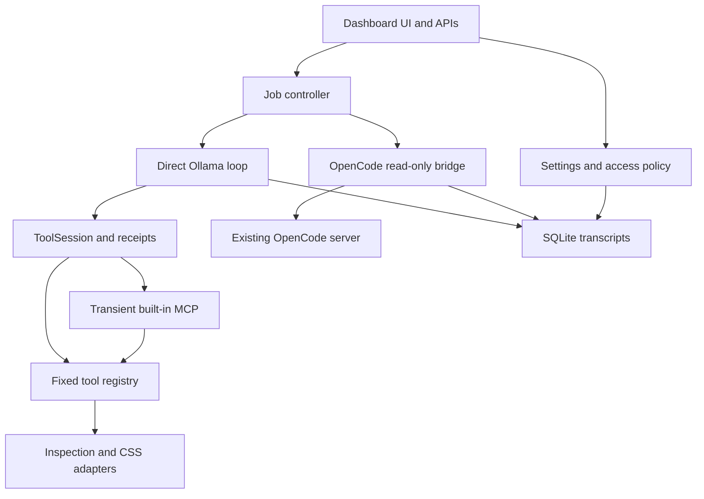
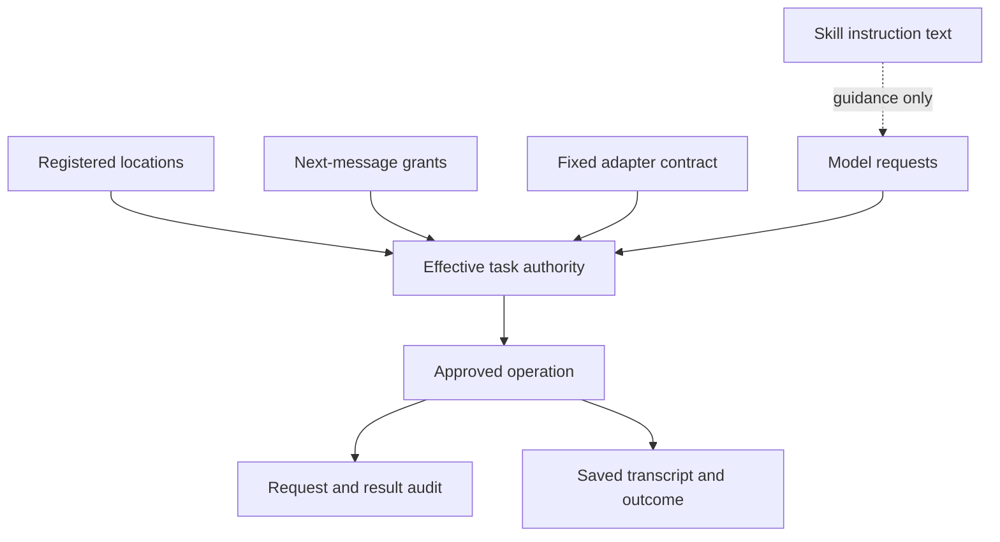

# System relationship maps

Pinned application source: `c9e541e9e0d53fcaba109170f8e5a201b500340d`. The graph combines static source relationships and a separately labeled set of manually reviewed runtime links. It is a custom offline source explorer inspired by Graphify-style navigation; Graphify was not installed or run.

## Files and graph semantics

| Artifact | Use |
| --- | --- |
| [Interactive graph](graph/system-graph.html) | Download/open locally; search files/functions, include tests, select relationship kind and inspect a node |
| [Graph JSON](graph/system-graph.json) | 216 application files, 1,229 function/callback declarations, 1,978 static relationships, unresolved expressions and limitations |
| [Runtime links](graph/runtime-links.json) | 25 manually reviewed connections including browser script loading, stdio launch and engine selection |
| [Pinned manifest](graph/source-manifest.json) | Original Git blob identities and paths for the application source inventory |
| [Function index](FUNCTION_INDEX.md) | Human-readable per-file declaration table with source links |
| [Review evidence](graph/review-evidence.json) | Fixture observations, not model-generated claims |

- `calls`: resolved lexical, imported-alias-candidate, same-class or JS lexical-binding relationship. Direction is caller → callee; `line` is the call site.
- `references`: a function used as a value, callback or descriptor. This is not evidence that it was called.
- `imports`: local module dependency. Direction is importing file → imported file. An import alone does not execute every function in that file.
- `runtime`: explicitly reviewed architectural connection. It can represent process launch, frontend asset linkage, indirect routing or persistence; it is not fabricated AST call evidence.
- `unresolved_calls`: expressions retained without an invented target. Most ordinary library calls and dynamically dispatched methods live here.
- `no_static_incoming`: review candidate only. HTTP hooks, callback registration, main programs and external callers require separate reachability analysis.

The interactive graph defaults to production file dependencies, not a 1,229-node hairball. Search for a function and click it to open its neighborhood. Arrowheads appear on highlighted edges. The details panel shows unresolved expressions and a pinned GitHub source link. Graph expansion does not execute code or contact external services. The source link opens GitHub only when clicked. Current browsers with DecompressionStream are required to unpack embedded graph data; JSON remains available without the explorer.

## Active execution relationships



The transient MCP child reconstructs ToolSession using the parent's policy and startup skill fingerprint snapshot. Preview launch is owned by the dashboard rather than that child. The direct Ollama endpoint and the OpenCode server's independently configured local model provider are separate service paths.

## Authority and evidence



These are application checks. The OS user boundary is unchanged. Process confinement is a separate missing layer; arbitrary external MCP execution is currently blocked from the GUI.

## Distinct catalogs and storage

| Path / registry | Active consumer | Relationship to GUI |
| --- | --- | --- |
| `skills/`, `.smelter/managed-skills` | Dashboard catalog, runtime fingerprint monitor | Active instruction source |
| `.smelter/skill-state.json` | Dashboard skill enable state | Separate JSON, not SQLite configuration |
| `.agents/skills` | Legacy core registry and CLI tooling | No automatic dashboard catalog bridge |
| `agents/skills` | Agent contract/scaffold files | Not the active managed dashboard catalog |
| `tool_registry.py` | Dashboard direct/MCP ToolSession | Active fixed model-tool dispatch |
| `core/smelter_registry.Registry` | Legacy capability experiments/adapters | Separate registry, not implicitly MCP-exposed |
| SQLite config_snapshots | Current dashboard model/extensions/runtime/access policy | Authoritative current settings |
| Old extension/model JSON | One-time migration / compatibility helpers | Preserved, no longer current dashboard truth |

## Regeneration

The Python builder parses source only and uses the standard library. JavaScript indexing requires a development Babel parser/traverser; these are not runtime dashboard dependencies. The checked graph was built with the available Babel bundle exporting `babelParse` and `traverse`. The indexer also supports ordinary `@babel/parser` and `@babel/traverse` modules in the developer's Node resolution path.

From the repository root, with those development dependencies already available:

```powershell
node tools/analysis/index_javascript.cjs . docs/graph/source-manifest.json js-index.tmp.json
python tools/analysis/build_system_graph.py --manifest docs/graph/source-manifest.json --js-index js-index.tmp.json --runtime-links docs/graph/runtime-links.json --index-output docs/FUNCTION_INDEX.md
python tools/analysis/render_system_graph.py docs/graph/system-graph.json docs/graph/system-graph.html
Remove-Item js-index.tmp.json
```

The pinned builder refuses changed application source hashes. To review later code, create a fresh Git-derived manifest or use `--revision <new-commit>` without `--manifest` for a working-tree scan, and create a matching JavaScript inventory. Do not relabel old hashes as a new revision. The working-tree scan intentionally excludes analysis utilities themselves; this separates the application under review from its analysis harness. Document that exclusion when comparing totals.

To reproduce the three remaining runtime defects safely:

```powershell
python tools/analysis/reproduce_review_findings.py
```

It uses temporary files, synthetic GLB bytes and an in-process OpenCode fixture. It starts no real model, Blender, game or external agent. It prints observations rather than asserting that defects must persist after fixes. Run the analysis unit tests with `python -m unittest discover -s tools/analysis -p "test_*.py"`.
