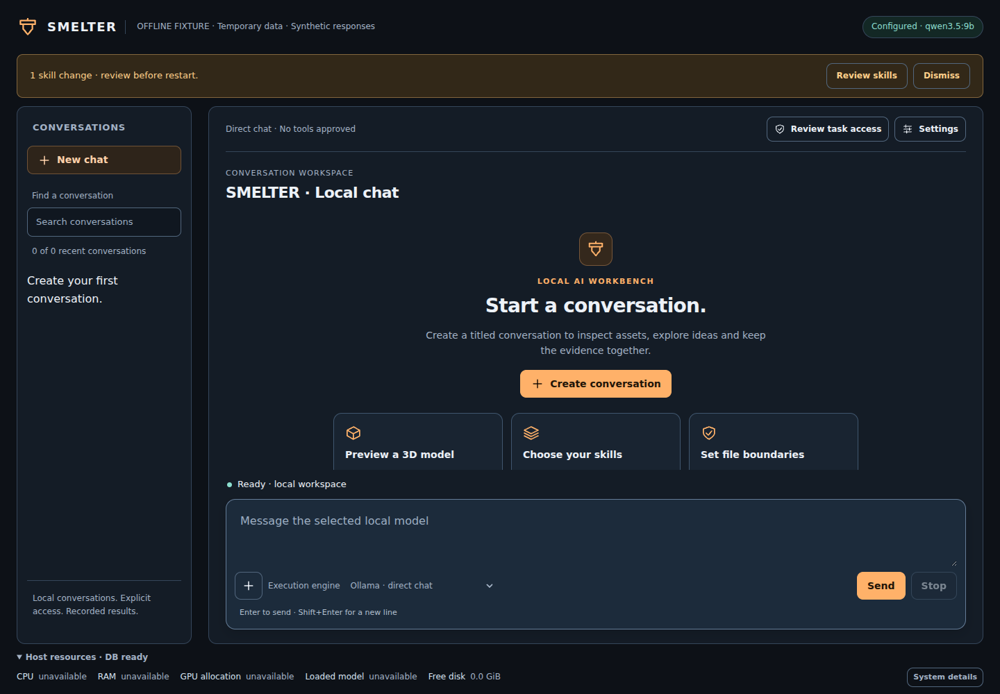
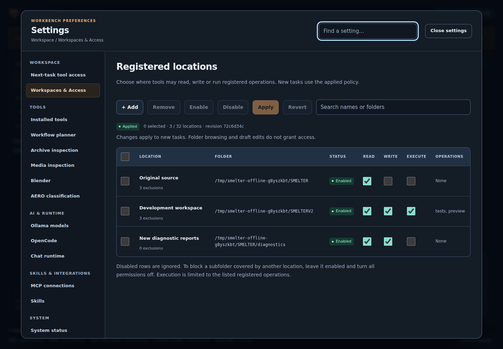
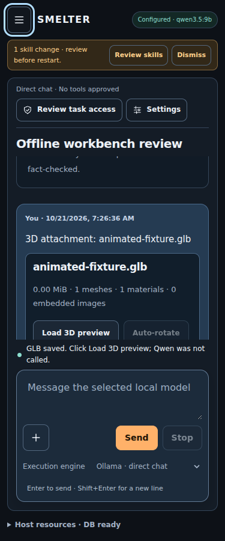

# UI/UX overhaul and review repairs

## Remembered OpenCode startup

Choosing OpenCode in the engine selector also authorizes that engine and enables
its OpenCode/MCP components. The browser remembers the engine; on the next GUI
load, authenticated database startup warms the confined OpenCode session in the
background. There is no additional Allow OpenCode checkbox or required connection
check. The session chip shows starting/ready/failure and retries a failed start.

This selects the engine only. File locations, selected skills and per-task host
tool grants retain their existing controls. Missing Docker, images or model
dependencies are reported rather than installed automatically. Switching to
direct chat clears the engine authorization in that page; component Stop remains
available in System status. Choosing OpenCode again enables its components.

## 2026-10-24: professional overhaul and persistent OpenCode

Driven by operator feedback after the first laptop install (cluttered settings,
an OpenCode check-and-approve step for every task, a large message box, a dated
look and a chat flow that needed a title before typing). The visual direction
came from the ui-ux-pro-max skill's design-system search (developer tool,
dense dashboard, subtle motion); its FAQ-page pattern and remote Google Fonts
were not used because the dashboard is an offline loopback app.

| Area | Change |
| --- | --- |
| Design system | Tokens on `:root`: slate surfaces (`#0b1120` → `#1b2336`), green run/accent `#22c55e`, info/warning/danger, 6/8/12 px radii, 34 px controls (44 px on touch), 14 px base text. JetBrains Mono (SIL OFL, `tools/dashboard/fonts/`) for code; IBM Plex Sans if installed, else Segoe UI Variable/system UI. Flush panes with hairline borders, visible focus rings, reduced-motion respected. The CSS stays in `dashboard.py`'s `<style>` so the frontend CSS workspace keeps working |
| Layout | 48 px header; sidebar and workspace as flush panes; the conversation title leads the toolbar; messages in a centred 872 px column; assistant replies flow on the page, user turns are compact bubbles; copy and row actions appear on hover/focus |
| Composer | One-line message box that grows to ~8 lines; one control row: attach · engine · OpenCode session chip · model chip · Tools chip · Stop · Send. The model chip opens Runtime & profiles; the Tools chip opens a popover with the per-send grants, the OpenCode session approval and Keep permissions |
| Settings | Five groups in a fixed order: **Model & runtime** (Runtime & profiles, Models, OpenCode agent), **Access & locations**, **Skills & MCP**, **System** (Installed tools, System status, Storage & backup) and **Debugging** (Task diagnostics — the former Next-task tool access, with the OpenCode connection check and REA check — Confined runner, Capabilities & checks, Workflow planner, Archive/Media inspection, Blender check, AERO classification) |
| OpenCode | `opencode_pool.py` keeps **one confined container per dashboard process**. It starts in the background when the dashboard loads with OpenCode selected or when you switch to it, is reused while image, model, runtime, policy and tool set are unchanged, refreshes the read-only code snapshot in place before each task, attaches the task's control and tool bridge and detaches them afterwards. Approval covers the dashboard session. The session is replaced after a relay error or unconfirmed abort and removed on dashboard exit. Confinement is unchanged |
| Chat workflow | No title dialog: the first Send creates the conversation, titled from the first line of the message. New chat clears the view and focuses the box. Direct chat is the default engine and the last choice is remembered |

Measured live on the laptop (Docker, no model call): first session start 13–20 s,
the next task attaches in about 1 s to the same container, and a file added under
`skills/` is visible inside the running container after the refresh. Browser
smoke `tools/analysis/check_workbench_browser.mjs` passes at 375/768/1024/1440 px
with no page errors or external requests.

Screenshots: [chat](screenshots/2026-10-24-chat-desktop.png) ·
[chat 375 px](screenshots/2026-10-24-chat-375.png) ·
[settings](screenshots/2026-10-24-settings-desktop.png) ·
[workbench](screenshots/2026-10-24-workbench-desktop.png).

## 2026-10-21: review repairs

This revision implements the seven reproduced R01–R07 findings and replaces the presentation of the workbench. It preserves existing API routes, request fields, per-message approvals, location-policy semantics and the separation between controller receipts and model narrative.

## Interface changes

| Area | Result |
| --- | --- |
| Main workspace | Consistent slate/amber design, clearer conversation title and role separation, restrained evidence/file cards, useful empty state |
| Composer | Attachment + menu, execution-engine choice, Send/Stop and keyboard hint in one place; a title is required before the first send |
| Navigation | Persistent conversation rail on desktop; an Escape-dismissable drawer with background interaction disabled on smaller screens |
| Settings | One searchable grouped centre, current-section context, keyboard focus return, common search terms and responsive section selector |
| Task access | Compact main-screen summary; full configured model/context/output/timeout details in next-task access; permissions remain explicit |
| Skills and locations | Searchable tables, parent/child selection and bulk controls; location drafts retain Apply/Revert and conflict protection |
| Folder selection | Authenticated operator-only metadata browser; selection and draft edits grant no model access |
| Runtime status | Configured model labelled as configuration; host CPU/RAM/disk and Ollama allocation distinguished from readiness/utilization |
| Errors | Inline form errors retained; conversation errors use dismissable notices; stale callbacks cannot update released previews |
| Mobile | Smaller composer/status footprint; adaptive resource disclosure; page-overflow checks at 375/768/1024/1440px |

The [design system](../design-system/smelter/MASTER.md) records the exact reference and deliberate overrides. UI UX Pro Max was read and its generator actually ran in CI at upstream commit `56ea9cf174ed86786187daa9de0e6247cb0747e4`. It matched Developer Tool / IDE and Dark Mode (OLED). Its FAQ landing-page composition was rejected as unsuitable for this operational tool. No hosted fonts, CDN icons, GSAP or new frontend framework were added.

## Review defect disposition

| ID | Repair | Verification |
| --- | --- | --- |
| R01 | Authorize each report filename, including collision suffixes; check top-level source reads and CSS temporary writes | Real temporary file tests, including direct and built-in MCP denials |
| R02 | Remove whole-POST locking; retain narrow mutation/admission and idle-maintenance guards; Stop bypasses unrelated state locks | Concurrent real HTTP probe/Stop test while the configuration lock is held elsewhere |
| R03 | Shared output-limit classification; truncated direct/OpenCode responses become partial terminal outcomes without repeating tools | Persisted direct result, truncated tool-call denial and one-poll OpenCode completion fixtures |
| R04 | One active preview owner for load/error/export/PNG; abort and detach on release; reset animation busy/timers; ignore stale callbacks/downloads | Actual embedded GLB rendering and controlled release during snapshots, stale load/PNG events, error/reload |
| R05 | Validate streamed packet/done/reason shapes; retain completed actions and partial model text on protocol failures | Local synthetic HTTP stream plus after-tool and no-tool partial transcript tests |
| R06 | Use host Path identity rather than unconditional case folding | Linux case-distinct folders and genuine duplicate rejection; Windows suite |
| R07 | Claim and roll back only newly created workspace data | Injected marker failure/retry and pre-existing data preservation tests |

The first Windows baseline CI run also exposed two test defects: implicit cp1252 decoding of UTF-8 source, and an unclosed SQLite fixture connection. Both were corrected without weakening the assertions.

The CSS tool's read list now includes the actual current shell/settings/access/skills components within its already-approved frontend source scope. Its edit surface remains CSS-only. OpenCode remains text-only/read-only; arbitrary external MCP is blocked and visibly labelled.

## Validation and provenance

Final application/graph source: **43ff086bac02a42c6257c91db983a307ff345f15**. Offline CI: **[run 39561889060](https://github.com/Dr-Dark92/SMELTER/actions/runs/39561889060)**.

Final observed results on both native CI operating systems: **359 dashboard tests**, **32 setup tests**, **four analysis tests** and **15 JavaScript tests**. Linux skipped two opt-in live model/Docker checks; Windows additionally skipped the Linux case-distinct-directory fixture. Actual Chromium workbench/GLB checks passed with zero page errors or external HTTP requests.

CI uses synthetic inference, disposable state and a generated embedded animated GLB. Browser checks cover settings search, location Apply/browsing, skills bulk selection, titled chat, attachments, animation playback/labels, PNG/WebM and preview lifecycle races. Representative token contrast is measured in the design-system document. No full WCAG certification, user-rig GPU benchmark or successful live Qwen/OpenCode inference is claimed.

The source graph is regenerated from Git blob identities, with static functions/relationships distinguished from manually reviewed runtime links. Analysis utilities and downloaded test dependencies are outside the application inventory.

## Run the updated GUI

Stop the old dashboard, then update the same checkout. Do not clean untracked files or overwrite V2/state.

CachyOS / fish:

```fish
cd ~/dev/SMELTER
and git pull --ff-only origin SMELTERV1
and python tools/dashboard/dashboard.py --no-browser
```

Open the new authenticated URL printed by the server. Starting the GUI does not require a Qwen inference. For disposable GUI exploration use `python tools/analysis/offline_gui_fixture.py`; add `--viewer-root /absolute/path/to/SMELTER` only when that checkout already has the validated local model-viewer bundle.

Existing V2 is a preserved snapshot. Pulling V1 does not refresh it; validation will reject a stale baseline. Preserve/archive any work before preparing a new workspace. This update does not delete or silently rebase existing V2/V2-Data.

## Remaining deployment work

- Live Ollama/Qwen quality, timings, context behavior and GPU allocation on the user's hardware.
- Live Docker/OpenCode image, provider/permission contract, local-model relay and container cleanup smoke tests.
- User-rig Windows process/socket/drive behavior beyond the successful hosted Windows contract suite.
- Screen-reader/manual keyboard checks, real browser zoom and longer conversations beyond the bounded fixture.
- A separately designed confined coding mode and external MCP adapter; neither is enabled by this UI overhaul.

## Actual fixture screenshots

These are screenshots from the tested application, using disposable data and synthetic replies.






