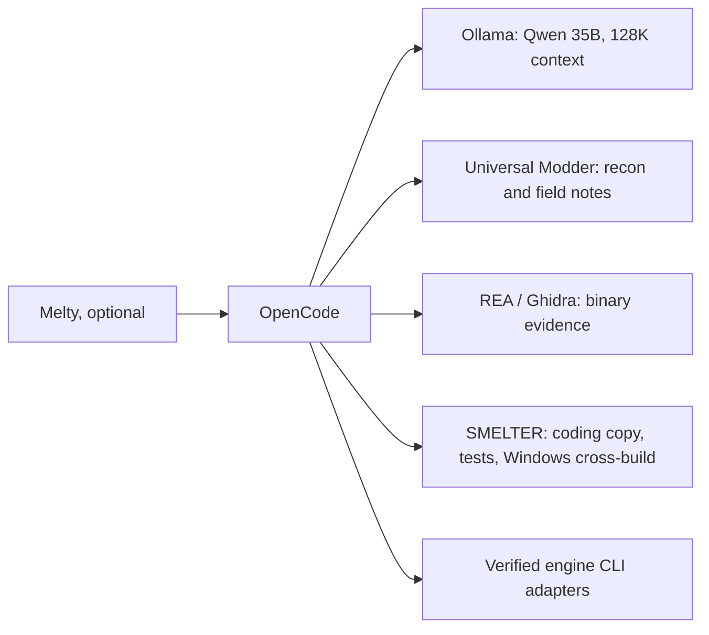

# Universal Modder: standalone CLI and SMELTER integration

Next stage implemented: [engine archive inspection](ENGINE_ARCHIVE_CLI.md) now
connects this knowledge/recon route to pinned repak, retoc and UnityDataTool
metadata through MCP. It adds an `engine-archive` skill and real ARK IoStore
evidence while preserving the local 128K Qwen profile.

Installed from [rehan-remade/universal-modder](https://github.com/rehan-remade/universal-modder),
version 0.2.0, pinned to commit
[`c1dff21663665dd17af289744a301b66e369605e`](https://github.com/rehan-remade/universal-modder/commit/c1dff21663665dd17af289744a301b66e369605e).
Reviewed source ZIP SHA-256:
`460f67aafbfa89c9420f8e60c156f3c2114fa777134846a3be4f991610c8f40d`.

This toolkit supplies a broad modding workflow, engine heuristics, shared field
notes, sprite/media processing, backup helpers and game-control commands. It can
run without Melty. Engine/version support and the required loaders still depend
on the specific game. It complements REA/Ghidra and engine-specific packers.

## Installation and identity

`system-requirements.json` declares the `universal_modder` setup/profile and the
pinned GitHub archive. Direct CLI/test dependencies are pinned in
`tools/modding/requirements-universal-modder.txt`: Pillow 13.0.0, numpy 2.5.4,
PyYAML 6.0.3 and pytest 9.1.1. This private environment requires Python 3.12+.

```powershell
python tools/setup/install_universal_modder.py
python tools/setup/install_universal_modder.py --enable
python tools/modding/um.py --version
python tools/modding/um.py --help
```

The install lives under `.smelter/tooling/universal-modder/`: complete source,
private `venv`, source manifest, installation receipt, pip download report and
resolved dependency versions. Source/dependency declaration drift is refused;
reinstallation does not silently replace edited vendor source. The launcher
isolates Python imports and avoids source bytecode caches.

The original `.smelter/tooling/melty` kit and its `um` copy are preserved. No global
PATH entry, OpenCode 2 plugin, FAL MCP connection or API key was added. The explicit
launcher avoids confusing the two copies. Upstream's OpenCode 2 passthrough plugin
is not needed by the installed OpenCode 1.19.3 route.

## Use it on its own

Run from the SMELTER checkout, or use an absolute path to `tools/modding/um.py`:

```powershell
# Read-only inspection of a specific installed game
python tools/modding/um.py scan "D:\SteamLibrary\steamapps\common\ARK Survival Ascended" --json

# Search the bundled field notes (no paid-service account required)
python tools/modding/um.py kb search "grand theft auto" --json --limit 3
python tools/modding/um.py kb show games/gta-v/minecraft-passthrough.md

# Discover optional CLI surfaces before using them
python tools/modding/um.py sprite --help
python tools/modding/um.py backup --help
python tools/modding/um.py video --help
```

The standalone CLI has the invoking agent/user's host permissions. Its broader
commands are explicit host actions. Put generated assets and new field notes in
separate working folders; do not write into the pinned toolkit's source/knowledge
tree. Blender/FFmpeg and asset-service configuration are needed only for their
respective commands. No paid service was called in this installation.

## Use it with Qwen/OpenCode and Melty



The registered MCP operation is `universal_modder` (OpenCode prefixes it as
`smelter_universal_modder`). It uses the existing coding-workspace grant:

- `{"action":"status"}` verifies the pinned installation without running it.
- `{"action":"search_notes","query":"grand theft auto"}` returns up to five
  results from the pinned local knowledge base. Explicit local roots prevent
  remote refresh or a different working-tree KB from being used.
- `{"action":"read_note","note":"games/gta-v/minecraft-passthrough.md","offset":0,"limit":6000}`
  reads an exact returned note with character pagination and its content hash.

The MCP adapter accepts fixed read-only operations, with an execution location
registered for `modding`. It does not accept arbitrary `um` arguments, remote
sync, game-control/restore commands, publication or asset-service calls. Native
OpenCode can separately invoke the standalone CLI within its own host permissions.

The new bundled `universal-modder` skill is also installed in native OpenCode's
skill directory via `configure_melty_cli.py`. Full upstream skills/playbooks remain
in the pinned source; the compact SMELTER skill describes the actual adapter.
For a managed binary investigation, select `universal-modder`, `mod-validation`
and the existing REA skill (three-skill limit). Reload the dashboard/OpenCode
session after adding tools/skills. Both saved model routes remain at **131,072
context / 8,192 output tokens**.

## Where it fits in GTA × ARK

1. Search prior GTA/mashup field notes; preserve their exact versions as evidence.
2. Standalone `um scan` identifies candidate engines/loaders/routes. Cross-check
   with SMELTER's bounded file-header inspection and the actual game build.
3. Use the passthrough field note for architectural ideas: independent game loops,
   explicit shared state, coordinate conversion and a small vertical slice. Its
   Minecraft/GTA result does not establish compatibility for this GTA/ARK pair.
4. Use REA/Ghidra for binary questions and the matching engine tools/SDK for assets.
5. Build the camera-link change in an isolated coding workspace; run Python, Lua
   and portable C++ tests, then cross-compile Windows artifacts. Keep the exact
   source/manifest/tool hashes.
6. Verify the game-specific loader/native route before an in-game run; then record
   actual behavior and update `MODLOG.md`. No loader/game modifications occurred
   during this toolkit integration.

## Verification and continuation

Real standalone recon reported RAGE for GTA V Enhanced and Unreal/IoStore for
ARK: Survival Ascended. It did not establish ARK's exact engine version. Real
stdio MCP status, local search and note reading passed. Initial source smoke:
`.smelter/universal-modder-runs/2f46a07194694dad8889a3503db5e292/smoke.json`.

Seven upstream engine/KB tests and 21 upstream sprite tests passed (28 total).
The sprite suite emitted one upstream Pillow deprecation warning; no failure.
SMELTER's installer/adapter tests cover ZIP traversal/links/collisions, checksum
rejection, source drift, grants, argument isolation and note-path/pagination bounds.

Reproduce the tools-only smoke with:

```powershell
python tools/analysis/smoke_universal_modder.py
python tools/analysis/smoke_universal_modder.py --scan-game "D:\SteamLibrary\steamapps\common\ARK Survival Ascended"
python tools/analysis/smoke_qwen_universal_modder.py
```

The last command is an opt-in real 128K local-model task, with a per-process
permission overlay allowing only the read-only UM MCP operation. It does not
change the native config, start the external REA server, or launch games. Its
evidence is retained under `.smelter/universal-modder-runs/qwen-*`.

### Completed live Qwen acceptance (25 October 2026)

The real native OpenCode/Qwen task passed at 131,072 context / 8,192 output.
Controller-visible events contain exactly two completed calls:
`search_notes` for `grand theft auto`, then `read_note` for
`games/gta-v/minecraft-passthrough.md`. Qwen returned an architectural suggestion
for a GTA-to-ARK camera link. The upstream note supports its WebSocket reference;
that is a design option, not a decision to replace the current GAL1 prototype.
The note explicitly targets GTA Legacy, so it does not prove the installed
Enhanced build/loader or ARK compatibility.

Live-model evidence:
`.smelter/universal-modder-runs/qwen-d09736b7c1474a7f9ecf96f470159144/report.json`.
Ollama `/api/ps` also reported the loaded model `qwen3.5:35b-a3b-128k` with
`context_length` 131,072. No shell/file-edit/game actions were allowed in the probe.

After integration: full dashboard suite **559 tests, OK (9 skipped)**; setup suite
**107 tests, OK**. The 28 focused upstream engine, KB and sprite tests passed.

The idle dashboard was refreshed after integration; the live authenticated
capability endpoint now lists `universal_modder` among 44 capabilities. Component
enable flags were restored and game/model settings preserved. The updated local
GUI was opened in the Codex browser panel. Melty's existing OpenCode session may
need reopening to discover the new MCP schema and skill.
