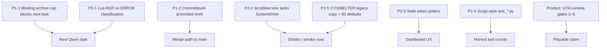

# SMELTER system review: fix map for Codex (28 October 2026)

Read-only review by Claude, carried out on branch `feature/agent-stack-game-mods`
at HEAD `876352f` with the working tree uncommitted. Apart from this file,
nothing was edited, staged or committed. The earlier Trace workbench layout
work is listed below because it is also uncommitted. Never stage
`dw3_decomp-main/`.

## Health snapshot (run during this review)

| Suite | Result |
|---|---|
| Dashboard Python (`unittest discover -s tools/dashboard`) | **805 OK, 9 skipped** (386 s) |
| Setup Python | 144 OK |
| Analysis Python | 30 OK |
| Web Python | 19 OK |
| Dashboard JS (`node --test test_*.js test_*.mjs`) | 83/83 |
| `tools/core`, `tools/bootstraps` | **0 tests ran** (see P2-4) |
| Live dashboard log since the 17:34 restart | 1138 × 200, 699 × 403, no 5xx, no tracebacks |

Codex's latest offline milestone (Lua 10/10, mods 14/14, frozen 128/128) was
not rerun here; its receipts are in `diagnostics/PASSIVE_SYSTEM_*_20261028.json`.

## Fix map

### P1: blocks the next work

**P1-1 · The native binding archive cap will refuse the next binding.**
`tools/dashboard/native_progress.py:235-236`: `_archive()` raises once ten
`archives/*.json` exist. Codex's resume checkpoint already counts ten. No API,
CLI or UI exists to export, review or prune them, so the next `bind` (every new
Qwen task) fails with "Ten native binding archives exist".
*Fix:* add an operator-only export action: zip the archives with a manifest and
SHA-256, verify the zip, then move them to a dated folder. Expose it in
`tools/setup` and, optionally, in the Native progress panel. Keep the cap, and
never delete silently.
*Done when:* a test shows binding #11 succeeds after export, export is
idempotent, and the manifest hashes match.

**P1-2 · Verified, promoted work exists only in the working tree.**
The branch is 2 commits ahead of `origin`, with 22 modified and about 20
untracked files: the provider, the passive entry, profiles, three new Lua
tests, four contracts, scaffolds, diagnostics and Claude's workbench layout.
`main` is still at `3f72721`, 10 commits behind. One bad `git checkout` or
disk event loses the milestone, and the `.smelter/checkpoints` archive is not
a substitute for history.
*Fix:* when the user approves, commit in two logical commits (backend
milestone, then workbench layout), push the branch, and plan a PR to `main`.
Exclude `dw3_decomp-main/` and the `%SystemDrive%/` folder.

### P2: correctness and operations

**P2-1 · Lua failures from custom assertions are reported as ERROR, not RED.**
`tools/dashboard/sandbox.py` (CODING_LUA, about line 326) counts a non-zero
exit as a *failure* only when stderr contains Lua's default `assertion
failed`. Any `assert(cond, "message")` or `error()` becomes ERROR. This is
exactly why the swallowed-stop and false-removal mutant probes produced
ERROR, not RED. The watchdog and finish tool treat ERROR differently from RED,
which distorts TDD loops.
*Fix:* recognise a deliberate assertion either by a traceback frame `in
function 'assert'`, or by a documented SMELTER marker such as
`SMELTER_ASSERT:` that an `expect()` helper emits. Keep import and runtime
errors as ERROR. Add mutant tests for both paths.

**P2-2 · Scrubbed child environments omit `SystemDrive`/`ProgramData`, so a stray folder appeared in the repo.**
On 25 Oct at 10:39, an empty tree `%SystemDrive%/ProgramData/Microsoft/Windows/Caches`
was created at the repo root. That is Windows expanding an unset
`%SystemDrive%` relative to the child's working directory. Suspects:
`tools/dashboard/ghidra_connection.py:112-113` (`_environment` allowlist) and
`tools/analysis/smoke_agent_bridge.py:188`. Neither passes `SystemDrive`,
`ProgramData`, `ProgramFiles` or `ALLUSERSPROFILE`.
*Fix:* add the read-only Windows location variables to both allowlists (not
`JAVA_TOOL_OPTIONS` or similar), then delete the empty folder. Add a test that
asserts the allowlist contains them on Windows.

**P2-3 · Tabs with a stale token poll forever.**
After the token rotated at the 17:34 restart, some open tab or window kept
calling `/api/native-progress` and `/api/task-trace/ws` every few seconds:
699 × 403 so far, and still going at 18:18. Startup handles 401/403
(`dashboard_shell.js:274`), but the background pollers (native progress,
trace socket, artifacts, skills status) retry indefinitely.
*Fix:* make a shared 401/403 handler stop all pollers and sockets, and show
the existing "Session authorization required" recovery once.
*Done when:* a JS test shows that one 403 halts every poller.

**P2-4 · `tools/core` and `tools/bootstraps` `test_*.py` are live scripts, not tests.**
`unittest discover` runs 0 tests in each, exit code 5. The files are
argparse scripts that need Ollama, `--root C:\SMELTER` and `qwen3.5:9b`
(for example `tools/core/test_unified_orchestrator.py:23-30`). They make the
test inventory look larger than it is, and any CI glob would silently skip
them.
*Fix:* rename them to `smoke_*.py` or move them under `tools/analysis/`, or
wrap them in `unittest` with a skip unless `SMELTER_LIVE=1`. Update
`docs/FUNCTION_INDEX.md`.

**P2-5 · Legacy `C:\SMELTER` checkout plus 93 hard-coded defaults.**
`C:\SMELTER` is an older clone on branch `SMELTERV1` (`e1d805f`) with 18 dirty
files and an empty `DB/`. 93 references default to it, mostly
`tools/bootstraps/*.ps1`, `automation/github-sync/Get-RepositoryState.ps1` and
`tools/core/*`. Running any of those acts on the wrong tree.
*Fix:* derive the root from the script location (`$PSScriptRoot`/`__file__`)
or `SMELTER_ROOT`. Ask the user whether to archive `C:\SMELTER`, and don't
delete it, because it has uncommitted changes.

**P2-6 · Melty and headless ACP share port 4096.**
Codex runs operator-owned headless OpenCode 1.19.3 on 4096; Melty expects to
start its own ACP there. The handover describes a manual stop and rebind
procedure only.
*Fix:* a `tools/setup` status/handoff command that checks the owner PID from
`.smelter/codex-headless-acp.json`, confirms idle, stops only that owner and
rebinds. Or run the headless instance on another port if the bridge allows it.

**P2-7 · `.smelter` has no retention policy for ad hoc diagnostics.**
It holds 375 top-level entries and 409 MB, including many one-off
`*-diagnosis-*`, `ghidra-smoke-*` and `codex-*.log` files. The
reviewed-retention work from 21 Oct (F08) covers artifacts and jobs, not these.
*Fix:* extend the retention plan with a dry-run list grouped by prefix and age,
plus operator-confirmed archiving. Never touch `checkpoints/` or private
dispatch records without review.

### P3: documentation and hygiene

- **Stale root handover.** `MASTER_HANDOVER.md` still describes the 24 Oct
  laptop with `qwen3.5:4b`. Point it at `docs/CURRENT_HANDOVER.md`, or refresh
  it for the desktop Qwen 35B state.
- **`docs/CURRENT_HANDOVER.md` is 1642 lines.** Keep only the current state on
  top and move dated sections into `docs/handovers/`.
- **Mojibake.** `docs/handovers/CODEX_RESUME_CHECKPOINT_20261028.md:1` shows
  `—`: UTF-8 bytes re-encoded as cp1252 by the writing tool. Rewrite it as
  UTF-8 and check the writer, for example PowerShell `Set-Content` without
  `-Encoding utf8`.
- **Line endings.** `core.autocrlf=true` and `.gitattributes` pins only skill
  files. The Lua, JS and Markdown that Codex and Claude write as LF trigger
  CRLF warnings and can change hashes recorded in promotion manifests. Add
  `*.lua text eol=lf` (and decide for `*.js`/`*.md`) before the next promotion
  that records SHA-256 values.
- **Smoke model pin.** `tools/analysis/home_smoke.py:141` requires
  `qwen3.5:9b`, while the desktop profile is `qwen3.5:35b-a3b`. It works only
  because 9b happens to be installed. Read the model from the hardware profile
  instead.
- **F01 (from DEEP_CODE_REVIEW) is still an architectural limit.** Child
  processes run as the user and are not OS-confined. Don't claim confinement
  beyond the policy layer.

## Product gaps (not defects)

GTA-ARK native gates 3–6 in `docs/GTA_PREDATOR_ADAPTER.md` are all open:
- no exact-build loader: Script Hook V supports 1.0.1158.13, but 1.0.1158.16
  is installed;
- no Lua host or transport inside GTA;
- no read-only native probe;
- no controlled spawn, move or attack capture;
- no raptor assets.

The 128 frozen checks are offline conformance only. Per the user's memory
rules, run the mod work through Qwen in SMELTER, and build or verify SMELTER
tools by hand only.

## Uncommitted Claude work (Trace workbench)

The layered relationship-graph layout is in the working tree only:
- `tools/dashboard/task_trace_graph.js`
- `tools/dashboard/task_trace_workbench.js`
- `tools/dashboard/test_task_trace_graph.js`
- `docs/TRACE_WORKBENCH.md` (see "Graph layout")

JS 83/83 and dashboard 805 OK with it in place. Leave these to the user or
Claude, or commit them separately from the backend milestone.

## Fix pass (Claude, 28 October, evening)

The user asked Claude to apply the fixes before the Codex handover. Nothing is
committed. Codex's own changed files were not touched, apart from the encoding
fix in its resume checkpoint.

| Finding | Status | Change |
|---|---|---|
| P1-1 archive cap | **Fixed and run** | `native_progress.export_archives()` plus `tools/setup/export_native_archives.py` move `archives/*.json` into `.smelter/native-progress/archive-exports/<UTC stamp>/` with a SHA-256 `manifest.json`, re-hashing each moved file. Nothing is deleted, the cap is kept, and the error message names the tool. It has already run once: 10 archives moved to `archive-exports/20261028T155948136421Z/`, and `archives/` is empty, so binding works again. Test: `test_archive_cap_is_cleared_only_by_a_verified_export`. |
| P1-2 commit | **Open, needs user approval** | Unchanged. |
| P2-1 Lua RED vs ERROR | **Deferred to Codex** | Not applied, on purpose. Any edit to `sandbox.CODING_LUA` changes `lua_runner_sha256()`, which invalidates every Lua receipt that records `runner_sha256`. Land it between milestones, then re-run the Lua proofs. |
| P2-2 child env | **Fixed** | `ghidra_connection._environment` now keeps `SystemDrive`, `ProgramData`, `ProgramFiles`, `ProgramFiles(x86)` and `ALLUSERSPROFILE`. `smoke_agent_bridge` had a second bug: it matched `os.environ` keys case-sensitively, and Windows upper-cases them, so it was dropping `SystemRoot` too. It now looks each name up. The empty `%SystemDrive%/` tree was removed. Test: `test_windows_environment_keeps_system_drive_so_no_relative_programdata_appears`. |
| P2-3 stale-token pollers | **Fixed and checked live** | `session_auth.js` wraps `window.fetch`. Once a request carrying `X-Smelter-Token` gets a 401 or 403, that token is latched as rejected: later requests with it return 403 locally with no network call, and `smelter-auth-rejected` fires once. `dashboard_shell.js` answers by showing the existing "Session authorization required" screen, and `task_trace_ui.js` stops reopening the socket with a rejected token. A new fragment token resumes everything without a reload. Live check: 0 API calls in 8 s with a bogus token, then a clean load with the real one. (The dashboard was restarted at 19:47, so the old link is dead.) Test: `one rejected request halts every later request…` in `test_session_auth.js`. |
| P2-4, P2-6, P2-7 | Open | Unchanged. |
| P2-5 C:\SMELTER defaults | **Partly fixed** | The only live script, `automation/github-sync/Get-RepositoryState.ps1`, now defaults to its own checkout. On PowerShell 5.1, `$PSScriptRoot` is empty inside `param()`, so it is resolved after the param block. The other 90 references are in legacy `tools/bootstraps`/`tools/core` experiment scripts and were left as they are. Archiving the `C:\SMELTER` clone needs the user's decision. |
| P3 mojibake | **Fixed** | `CODEX_RESUME_CHECKPOINT_20261028.md` line 1. |
| P3 line endings | **Fixed** | `.gitattributes`: `*.lua text eol=lf`. No file was rewritten. Two working copies still hold CRLF bytes (`mods/gta-ark/tests/test_entity_policy.lua` is mixed, `tools/dashboard/acceptance/predator_controller_v1.lua` is CRLF), so normalise them before recording their SHA-256 in a promotion. |
| P3 MASTER_HANDOVER | **Fixed** | Now points to `docs/CURRENT_HANDOVER.md` at the top. |
| P3 `qwen3.5:9b` pin | Reclassified: intended | The smoke fixtures (`smoke_agent_bridge`, the ECC smoke, `home_smoke`) consistently use 9b as a small, fast smoke model. |
| P3 CURRENT_HANDOVER length | Open | Codex owns that file. |

After the pass every suite passes: dashboard Python 807 OK (9 skipped), setup 168 OK (Codex added tests), analysis 30 OK, web 19 OK, JS 85/85.

Files Claude changed in this pass:
- `tools/dashboard/native_progress.py`
- `tools/dashboard/test_native_progress.py`
- `tools/setup/export_native_archives.py` (new)
- `tools/dashboard/ghidra_connection.py`
- `tools/dashboard/test_ghidra_connection.py`
- `tools/analysis/smoke_agent_bridge.py`
- `tools/dashboard/session_auth.js`
- `tools/dashboard/test_session_auth.js`
- `tools/dashboard/dashboard_shell.js`
- `tools/dashboard/task_trace_ui.js`
- `.gitattributes`
- `MASTER_HANDOVER.md`
- `docs/handovers/CODEX_RESUME_CHECKPOINT_20261028.md` (encoding only)

The Trace workbench files also changed: layer colour coding was added after the review.

## Suggested order

Remaining: P1-2 (once the user approves) → P2-1 (between milestones; then re-run the Lua proofs) → P2-4/P2-5 → P2-6/P2-7 → CURRENT_HANDOVER trim.
Then resume the GTA runtime gates.

## RPH read-probe gate preparation (Claude, 28 October, 20:45)

Nothing is committed. The gate is **not cleared**.

**Verified before changes:** every hash in `MANAGED_LUA_HOST_20261028.json` and
the probe sources match. The staged plugin is `456c1006…`. The installed
`GTA5_Enhanced.exe` is still `b48e80f5…` (1.0.1158.16). Dashboard, OpenCode (4096)
and Ollama are up, with no model loaded and GTA not running. No RPH files are in
the game folder.

**Codex and Claude worked on the gate in parallel.** Codex added
`verify_runtime_probe.py`, `inspect_loader_runtime.py` and
`read_probe_expectations.json`. Claude removed its own duplicate verifier and kept
only the missing piece: `tools/setup/stage_native_read_probe.py plan|apply|remove`.
It is registered as `runtime_probe_deployment` in `system-requirements.json`, in
REQUIREMENTS.md and in the probe guide, and tested by
`test_stage_native_read_probe.py` (8 tests). Pins come from Codex's expectations
profile. Setup: **186 OK**.

Two checks from Claude's withdrawn verifier that Codex may want to add to
`verify_runtime_probe.py`:
- the plugin **deployed** in `<game>/Plugins/` hashes to the staged plugin;
- the log line `[SMELTER] Native read-probe receipt: <path>` names *this* report,
  not just any mention of the plugin.

**Facts from the author page** (read-only, 28 October):
- RPH Enhanced is distributed **only inside the LSPDFR 0.4.9 (Build 9695) Enhanced
  1158.16 download**. The install tool copies only top-level `RAGEPluginHook*`
  files and lists everything else as excluded.
- Download requires a signed-in lcpdfr account, which is why backend requests
  were redirected.
- RPH needs the **BattlEye launcher disabled**.
- Defender currently flags RPH as a false positive; the authors suggest
  temporarily disabling AV.
- On NVMe, RPH warns about DirectStorage and links a third-party fix.

These are user decisions: account, download, anti-cheat launcher, AV and any
extra fix. No agent may change security settings.

**Next, with the user present:**
1. The user signs in and downloads the archive.
2. `inspect_loader_runtime.py <zip>`.
3. Extract to a separate folder.
4. `stage_native_read_probe.py plan`, review the excluded list, then `apply`.
5. The user starts RPH in Story Mode and loads `SmelterNativeProbe` once.
6. `verify_runtime_probe.py --latest`.
7. `stage_native_read_probe.py remove` if the user wants the folder restored.

The six-capability provider and cougar demo follow only after a pass.

### Runtime obtained and plan drafted (29 October, 03:1x UTC)

The user downloaded `lspdfr_049_9695_Manual_Install_Enhanced_1158_16.zip`
(86,824,044 bytes, SHA-256 `8524e534f219c7f33634ed45ced055f3c7b0b461fa8302ff2f0ac46470c7ed34`).

- **Inventory:** `.smelter/runtime-inventories/rph-enhanced-20261029T031054483442Z.json`,
  1,086 members. `RAGEPluginHook.exe` is **1.132.1428.17748**, SHA-256 `73f05b3f…42ac`.
- **Selection rule changed.** RPH's readme says to put everything except the `SDK`
  and `Licenses` folders into the game folder, so the tool now selects every
  top-level file (RPH plus about 20 dependencies, including `XInput1_4.dll`).
  LSPDFR is everything in `plugins/` and `lspdfr/`, and stays out.
- **New `extract` subcommand.** It copied the 24 top-level files to
  `.smelter/native-read-gate/runtime/8524e534f219c7f3/`; all match the inventory.
- **Plan:** `.smelter/native-read-gate/plans/8db4d2450a85407f8ddfc717037eede3.json`,
  applicable, 25 copies (24 RPH files plus `Plugins/SmelterNativeProbe.dll`), no
  existing targets. **Not applied.**

Setup suite: OK.

### First attempt paused (29 October, 07:2x local)

- Install `fe97fe29…` applied 25 files. The user started `RAGEPluginHook.exe`
  (1.132.1428), which created `RagePluginHook.ini`, an empty `commandline.txt`
  and `startup.rphs`, then waited idle without starting GTA or writing a log.
- **Cause:** GTA V Enhanced had never been launched (no
  `Documents\Rockstar Games\GTAV Enhanced` folder), so its first-run sign-in,
  terms and shader setup had not happened.
- **Removed:** all 25 files, none changed by the user, and the `Plugins` folder.
  RPH's three config files remain; the game ignores them.
- **Next:**
  1. The user launches normally once (with BattlEye, no hook DLLs present) and
     reaches Story Mode control.
  2. Re-run `plan` on `.smelter/native-read-gate/runtime/8524e534f219c7f3`, then
     `apply`.
  3. Run RPH with the BattlEye launcher off and load the probe.
