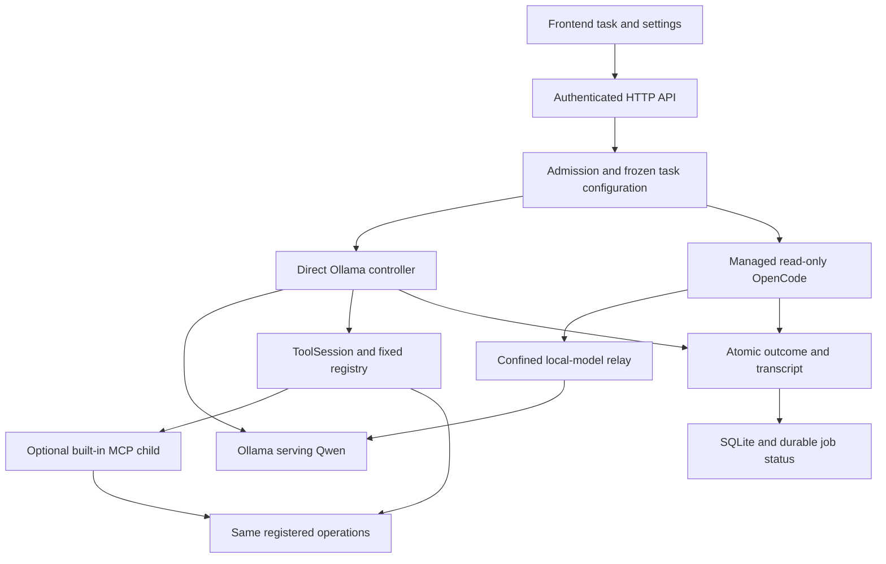

# SMELTER runtime and GUI review

Reviewed 2026-10-21. Repository: [Dr-Dark92/SMELTER](https://github.com/Dr-Dark92/SMELTER/tree/a609148fab2dec8915da24ca46550f9cd275b694), branch **SMELTERV1**, pinned source **a609148fab2dec8915da24ca46550f9cd275b694**.

## Assessment

The layers are connected, but the integration is narrower and more fragile than the GUI originally suggested. The direct engine has a fixed tool registry and a bounded loop; OpenCode is a separate read-only container pilot; MCP transports registered tools and does not turn a skill into executable capability. Qwen supplies responses/tool calls through Ollama. There is no training pipeline that learns new tool implementations or changes Qwen weights.

**Seven defects were reproduced in isolated fixtures. None is repaired by this review.** The first priority is consistent path-policy enforcement, followed by cancellation, protocol/outcome handling and GLB lifecycle ownership. Increasing model size or replacing Qwen would not repair these controller defects. Actual Qwen quality/speed cannot be assessed here because live inference was deliberately not run.

The 347-test dashboard suite still passes (two opt-in skips). That establishes covered behavior, not absence of the defects below.

## Provenance and coverage

- Fetched the GitHub branch ref and recursive tree, then verified **247 scripts** beneath tools/automation against their Git blob SHA-1 identities: zero source mismatches.
- Manually traced **43 files** across the requested layers. [scope.json](scope.json) records each file, indexed declarations and largest branch estimate. This is a critical-path review, not a claim that every branch in all 247 scripts was exercised.
- The existing [function index](../../FUNCTION_INDEX.md) and [system graph](../../graph/system-graph.html) pin application commit `e27036e0`. The reviewed `a609148` revision adds documentation/graph only and has the same application code.
- Reproductions: [runtime evidence](evidence.json), [GLB browser evidence](glb-browser-evidence.json), and [fixture script](../../../tools/analysis/review_runtime_layers.py). All writes used temporary databases/workspaces. User GLBs were read for preview tests; their bytes were not changed or committed.
- No live Qwen/Ollama inference, OpenCode agent task, Docker service, REA, Blender or native Windows process was run. Chromium software WebGL rendered the GLBs. Native GPU speed is unmeasured.
- Historical F01–F11 in [the older review](../../DEEP_CODE_REVIEW.md) are not silently reopened. Its [repair record](../../REPAIR_STATUS_20261021.md) remains historical evidence; R01–R07 below are newly checked issues at this pinned revision.

## How the layers currently connect

| Layer | Entry points and traced behavior | Current boundary / practical consequence |
| --- | --- | --- |
| Frontend | `dashboard_shell.js:initShell`, Send/Stop/resume, `openChat`, `executionCards`; settings, locations, attachments and renderer components | Shows controller evidence separately from model prose. History opening/deletion is guarded while the composer is disabled; a suspected ordinary cross-chat navigation issue was rejected after inspecting that guard. |
| HTTP | `dashboard.handler`, `ApiRoutes.do_GET/do_POST`, engine/model/MCP routes | Loopback server, token plus Origin checks, bounded JSON-object bodies, structured common errors. All POST dispatch currently holds a global lock: R02. |
| Admission | `Jobs.start`, `configuration`, `Policy`, `check_grants`, `job_store.admit` | Freezes policy and model/runtime revision; one admitted active job per database; rejects stale GUI revisions and arbitrary external MCP grants. Permissions are per message. |
| Jobs / persistence | `Control`, `Jobs._run/_finish/_persist/status`, `finalize`, `finalize_in_transaction` | Stop uses cancellation plus socket shutdown; transcript and terminal outcome share a transaction. Journal-only failures retry metadata without replaying tools. Unhandled protocol exceptions can bypass transcript finalization: R05. |
| Qwen integration | `_messages`, `_tool_loop`, `OllamaTurn.infer`, `context_budget.bounded` | Qwen is selected by model name, not implemented by a SMELTER training module. Context contains bounded history, selected skill instructions and only approved tool schemas. Tool/image turns force direct responses. |
| Ollama service | `Control.infer` and `OllamaTurn` reach fixed native `/api/chat`; `ollama.list_models` only discovers `/api/tags` | SMELTER does not install/start/tune GPU drivers or learn model weights. Discovery does not prove inference readiness. Streaming/protocol and finish handling have R03/R05 gaps. |
| Direct tools | `ToolSession` grant checks, audit, deduplication, call budgets; `tool_registry.schemas/execute_builtin` | CSS workspace, report, inventory, GLB metadata and fixed REA tools. Native archive/media/Blender paths are separate operator workflows. Enabling a skill does not create a callable adapter. |
| MCP | `exchange/_exchange`, `mcp_server.serve`, fixed ToolSession dispatch | Optional exact SDK 1.30.0; fresh stdio process per operation. Built-in preview launch stays owned by the dashboard. External server configuration can be saved, but external discovery/execution is blocked in active API/admission paths. |
| OpenCode | `status`, `session_rules`, `ask`, `_progress`; `ManagedClient` BOOT, queue and native relay | Exact version 1.19.3 and permission API checked; default production path uses a no-network container and read-only snapshot. Accepts text-only approved sessions. Design skill selections, GLBs, images and SMELTER write grants are not forwarded. |
| Confinement | `sandbox.status/_flags/snapshot/tests/preview/_remove/reconcile`, `process_runner.run` | Requires local immutable images and verified engine capabilities; no host execution fallback. Native fixed inspections have IO/process cleanup limits, not filesystem confinement. Live Docker/Windows validation remains open. |
| Skill bridge | `catalog_skills`, `SkillMonitor`, `build_skill_context`, `route_skills` | Startup fingerprints/restart activation, explicit selections, bounded text and deterministic routing. Auto-routing currently covers documentation/diagrams, not arbitrary learned skill choice. Scripts mentioned in manifests are not automatically executed. |
| GLB | `attach_model`, `inspect_glb`, `model_path`, `rename_animation`, `inspect_attachment`; browser preview/animation/turntable | Embedded assets only, 25 MiB upload, container/resource checks, UUID ownership, metadata labels without rewriting GLB. Rendering is browser-side. Lifecycle defects R04 remain. |

## Reproduced findings

Priority: **P1** resolve before expanding agent authority; **P2** material correctness/reliability; **P3** lower-impact portability/usability. Reproduced means the recorded fixture observed the failure, not that every deployment has encountered it.

### R01 — P1 — Final file policy is not consistently checked

**Confirmed by actual temporary file operations.** [write_markdown](https://github.com/Dr-Dark92/SMELTER/blob/a609148fab2dec8915da24ca46550f9cd275b694/tools/dashboard/python_tools.py#L197) authorizes the diagnostics directory and then chooses/writes a filename without authorizing that final path. A policy excluding `blocked*.md` rejects `Policy.authorize(.../blocked-report.md, 'write')`, yet the real ToolSession writes that file and returns `written`.

A second path is [frontend_workspace._source_files/prepare](https://github.com/Dr-Dark92/SMELTER/blob/a609148fab2dec8915da24ca46550f9cd275b694/tools/dashboard/frontend_workspace.py#L41). Per-file checks cover tools/skills, but top-level README/REQUIREMENTS/MASTER_HANDOVER selection omits the read check. The fixture excludes README, confirms policy denial, then observes its content copied into the new V2 workspace.

Impact: configured exclusions can be bypassed by approved built-ins. This reproduction establishes a policy-enforcement defect inside registered roots, not arbitrary code execution. Fix every concrete source/destination target, including collision suffixes and temporary replacement paths; add direct/MCP parity tests before expanding write authority.

### R02 — P2 — Global POST lock can delay Stop

**Confirmed with real local HTTP requests and synthetic workers.** [ApiRoutes.do_POST](https://github.com/Dr-Dark92/SMELTER/blob/a609148fab2dec8915da24ca46550f9cd275b694/tools/dashboard/dashboard_api.py#L43) holds `STATE_LOCK` for the full dispatched POST handler. A slow MCP probe therefore holds the same lock required by an unrelated Stop request.

The fixture held a probe for roughly 350 ms after Stop was sent; the cancellation event stayed unset until the probe was released. Production discovery can wait much longer. The cancellable socket reader does not help when the Stop request has not reached `Jobs.cancel`.

Move long IO/process/probe work out of the global configuration lock. Keep narrow mutation/admission transactions and explicit operation locks. Verify Stop delivery while each long handler is in flight, including a different browser tab.

### R03 — P2 — Output-limit termination has inconsistent outcomes

**Confirmed in both parsing paths.** [chat_inference._tool_loop](https://github.com/Dr-Dark92/SMELTER/blob/a609148fab2dec8915da24ca46550f9cd275b694/tools/dashboard/chat_inference.py#L42) receives `done_reason='length'` but does not mark the answer partial. The fixture persists a truncated answer with status **completed**.

The relay preserves `length`, but [OpenCode._progress](https://github.com/Dr-Dark92/SMELTER/blob/a609148fab2dec8915da24ca46550f9cd275b694/tools/dashboard/opencode_runtime.py#L197) recognizes completion only for `finish='stop'`. A completed length-limited assistant message returns `finished=False`, leaving the polling loop to wait/retry until timeout rather than immediately reporting a partial terminal result.

Normalize finish reasons for both engines. Preserve partial text and receipts, stop polling on a terminal length result, and label the output limit explicitly. Do not auto-repeat an edit/tool action to obtain more tokens.

### R04 — P2 — GLB preview lifecycle races leave invalid controls

**Confirmed in Chromium using the actual viewer and uploaded GLBs.** [model_preview.js](https://github.com/Dr-Dark92/SMELTER/blob/a609148fab2dec8915da24ca46550f9cd275b694/tools/dashboard/model_preview.js#L6) has generation guards around async loading, but its viewer load/error callbacks and export/PNG continuations are not consistently tied to active ownership.

1. Start WebM export, hold a snapshot pending, release preview, finish the cancelled snapshot, then load that card again. Animation controls remain disabled. `setBusy(true)` was applied before export; `clear()` disables the panel; the export finalizer resets busy only when `active===entry`, which is false after release.
2. Dispatch a late load event on the released viewer. Its callback enables Save PNG and rebinds animation controls despite the viewer being removed. This also creates a timer for a released instance.

Use a per-preview owner/generation token for every callback and continuation; reset busy/timers on release; suppress stale downloads/control updates. PNG completion after release needs the same guard. Reproduce cancellation, error, navigation and rapid preview replacement before accepting the fix.

### R05 — P2 — Malformed model stream can lose transcript finalization after a tool action

**Confirmed with a real fixture HTTP stream, plus a controlled after-tool failure.** [Control.infer](https://github.com/Dr-Dark92/SMELTER/blob/a609148fab2dec8915da24ca46550f9cd275b694/tools/dashboard/chat_jobs.py#L94) decodes each NDJSON line then calls `.get` without first requiring an object. A legal JSON array `[]` produces `AttributeError` instead of a normalized protocol error.

`chat_inference.ask` catches ValueError/OSError for partial receipt preservation, but this shape failure escapes. The after-tool fixture writes a real Markdown report and its JSONL result, then raises the same protocol exception: the conversation has **zero messages**, even though the action and audit exist. Jobs has a generic terminal error handler, so this is primarily loss of transcript/evidence linkage, not proof that the controller stays running forever.

Validate every decoded packet/message/done field. Convert expected external-protocol failures into typed adapter errors and ensure completed tool receipts reach terminal persistence. Preserve partial streamed text. Do not merely hide arbitrary programming exceptions with a blanket successful response.

### R06 — P3 — Location deduplication treats Linux paths as case-insensitive

**Confirmed on Linux with distinct directories/inodes.** [access_policy.validate](https://github.com/Dr-Dark92/SMELTER/blob/a609148fab2dec8915da24ca46550f9cd275b694/tools/dashboard/access_policy.py#L35) unconditionally case-folds resolved paths for duplicate detection. `Case` and `case` are different directories on this fixture filesystem but the policy rejects them as duplicate locations. The new GUI preserves Linux case, so an accepted draft can fail at Apply.

Use platform/filesystem-appropriate path identity. Cover both Windows drive spelling and Linux case-distinct directories; keep genuine resolved aliases rejected. This does not loosen traversal/root/link restrictions.

### R07 — P2 — Failed workspace preparation leaves data that blocks retry

**Confirmed by an injected marker-write failure after actual database creation.** [frontend_workspace.prepare](https://github.com/Dr-Dark92/SMELTER/blob/a609148fab2dec8915da24ca46550f9cd275b694/tools/dashboard/frontend_workspace.py#L98) creates V2 and its separate V2-Data database, then writes its workspace marker. On failure it deletes newly created V2 but leaves newly created V2-Data.

The fixture observes V2 removed, V2-Data remaining, and retry failing with `Isolated preview data directory already exists; refusing to reuse it`. The create-only guard is correct for pre-existing user data; ownership-aware failure cleanup is missing.

Track precisely which artifacts this invocation created. Clean only those artifacts, or leave an explicit recoverable journal/reconciliation path. Never solve retry by deleting an arbitrary existing V2-Data directory.

## GLB verification detail

| File | Size in bytes | Embedded clips | Actual browser result |
| --- | ---: | ---: | --- |
| Tabern.glb | 3,872,852 | 0 | Visible model; PNG export; WebM turntable |
| wargreymon.glb | 16,449,200 | 23 | Visible model; clip selection/play/pause; saved label; PNG |
| metalgreymon.glb | 17,867,180 | 42 | Visible model; clip selection/play/pause; saved label; PNG; R04 reproduction |

Browser run recorded zero page errors and zero external HTTP requests. FFprobe verified the exported Tabern WebM as VP8, 960×600, about 5.916 seconds, 719,441 bytes. This is one actual video export, not a guarantee for every browser/model. No GIF encoder is implemented. Friendly clip labels are metadata; source names and GLB bytes remain unchanged. Rendering is local and does not grant Qwen visual understanding.

## Weaknesses and deployment gates

| Item | Classification | Consequence / next check |
| --- | --- | --- |
| OpenCode cannot perform a redesign/write task | Deliberate current capability limit | Its production adapter denies writing/commands and excludes selected SMELTER design skills. Provide an approved confined coding mode later, rather than telling this mode to edit. |
| Direct frontend task edits only CSS | Deliberate current capability limit | HTML, Python and JS behavior stay fixed. The readable-file list still names old preview/support files rather than the new shell/settings components; plan a versioned frontend capability contract. |
| External MCP server appears configurable but is blocked | Backend restriction with confusing GUI affordances | Label disabled support explicitly and expose why discovery cannot run; do not remove the backend restriction as a cosmetic fix. |
| OpenCode GUI says it is checking an existing local server | Stale wording | Active path starts an owned inspection container/relay, without a model prompt. Update the text; connection readiness is not successful inference. |
| MCP timeout / Stop contract | Source-confirmed transport limit, deployment testing open | Child exchange has its own 120-second default timeout and no job cancellation handle; active tool bounds differ from model timeout. Test cancellation/process ownership and late action/audit outcomes. |
| Model metrics/capability preflight | Missing operational evidence | Capture selected model ID/digest, admitted settings, context-budget estimate, prompt/decode timings and actual tool-contract results on the rig. No claim that the model itself is defective. |
| Docker/OpenCode/Windows | Implementation present; live integration unverified | Real image startup, permission API, offline SDK behavior, mounts, relay cancellation and Windows Job Object cleanup must pass opt-in checks. A passing fixture is insufficient. |
| Existing V2 snapshot | Expected immutable baseline behavior | Pulling V1 does not upgrade an existing prepared V2. Source changes make validation stale. Add an explicit reviewed refresh/rebase flow; preserve user work. |

## Complexity and loose ends

The AST branch estimates flag review/refactoring candidates, not measured cognitive complexity or defect counts:

| Function | Branch estimate | Suggested separation |
| --- | ---: | --- |
| `model_assets.inspect_glb` | 48 | Container framing, embedded-resource policy and structural summary |
| `ManagedClient._native_response` | 47 | History normalization, limits, native request, response/SSE conversion |
| `process_runner.run` | 47 | Platform ownership, pipe drain, budget supervision and result mapping; preserve one cleanup owner |
| `python_tools.inventory` | 42 | Traversal, admission/filtering and bounded response construction |
| `opencode_runtime.ask` | 40 | Session verification, polling, cancellation/cleanup and shared finalization |
| `dashboard_shell.executionCards` | 40 | Renderer per receipt/result type |
| `access_policy.validate` | 39 | Schema/identifier checks, platform path identity and permission schema |
| `mcp_connections.validate_config` | 38 | Process path validation, server identity and allowed-tool schema |

`extensions.load_state/save_state` and `model_preferences.load_preferences/save_preferences/configure_model` remain compatibility JSON helpers. Search found no active dashboard consumer beyond the legacy helper chain; tests still use them. Deprecate deliberately before removal. No-incoming static symbols, HTTP hooks, SDK callbacks and injected fixtures must not be bulk-deleted as dead code.

The biggest avoidable coupling is the closure-heavy frontend shell plus a process-global POST lock. Refactor around explicit task/preview owners and narrow state transactions after behavior regressions cover the confirmed failures. Another large rewrite before those contracts exist would make the evidence harder to preserve.
